# Perancangan Arsitektur Sistem SIMON PST

## Tujuan

Dokumen ini menjelaskan rancangan arsitektur sistem SIMON PST berdasarkan struktur proyek saat ini. SIMON PST adalah aplikasi internal untuk monitoring kinerja harian petugas Pelayanan Statistik Terpadu dengan stack utama Next.js App Router, TypeScript, Prisma, PostgreSQL, NextAuth, dan pnpm.

## Ringkasan Arsitektur

Sistem memakai arsitektur web monolitik berbasis Next.js. Lapisan UI, routing halaman, API route handlers, autentikasi, logika bisnis, validasi, dan akses database berada dalam satu aplikasi. Database PostgreSQL menjadi penyimpanan utama, sedangkan Prisma dipakai sebagai ORM dan migration manager.

## Arsitektur Teknologi

Arsitektur teknologi SIMON PST terdiri atas lapisan antarmuka yang dibangun menggunakan Next.js, React, TypeScript, dan Tailwind CSS. Lapisan aplikasi menangani halaman dashboard, API internal, autentikasi pengguna, otorisasi berbasis role, validasi data, serta proses bisnis penilaian harian, dashboard, laporan, notifikasi, dan Evaluasi, Reward, dan Punishment.

Pada sisi data, Prisma ORM menjadi penghubung antara logika aplikasi dan PostgreSQL. Prisma juga dipakai untuk schema, migration, seed data awal, dan query database. Pengguna mengakses SIMON PST melalui peramban pada komputer yang terhubung ke server aplikasi internal. Server aplikasi menjalankan Next.js, membaca konfigurasi dari environment variable, lalu berkomunikasi dengan PostgreSQL sebagai penyimpanan utama.

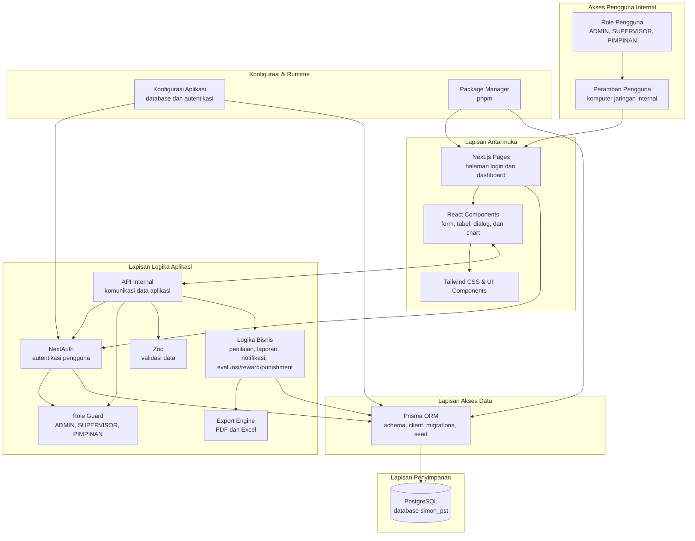

## Diagram Arsitektur Sistem

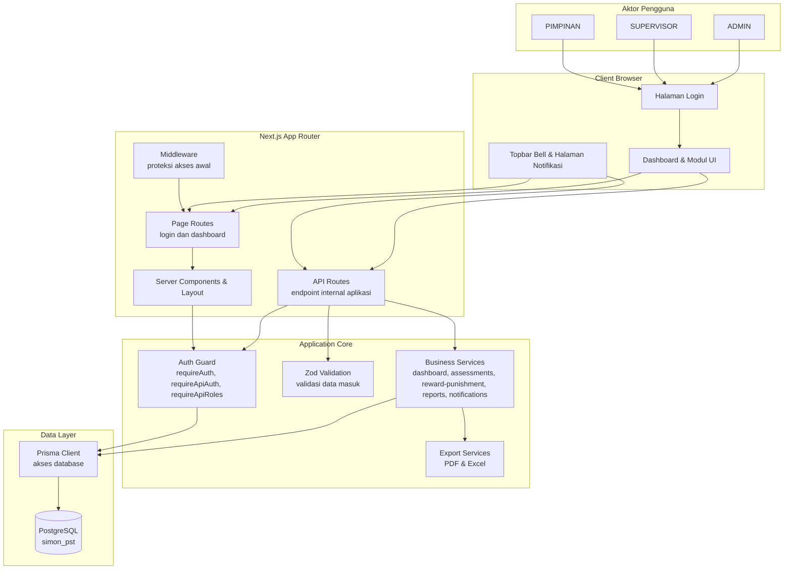

## Container dan Layer Sistem

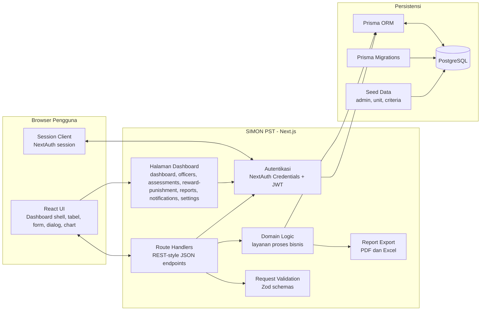

## Modul Utama

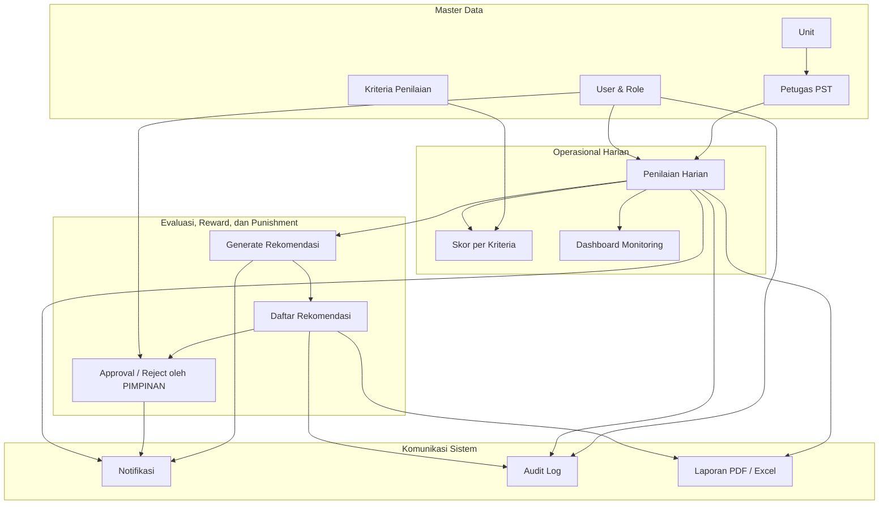

## Perancangan Use Case

Use case menggambarkan interaksi pengguna dengan fungsi utama aplikasi SIMON PST. Pada sistem ini, `ADMIN` berinteraksi dengan pengelolaan master data, pengaturan pengguna, input penilaian, pembuatan rekomendasi Evaluasi, Reward, dan Punishment, laporan, serta notifikasi. `SUPERVISOR` berfokus pada operasional penilaian petugas, pemantauan dashboard, pembuatan rekomendasi, laporan, dan notifikasi. `PIMPINAN` berinteraksi dengan dashboard monitoring, evaluasi rekomendasi, persetujuan atau penolakan rekomendasi, laporan, dan notifikasi.

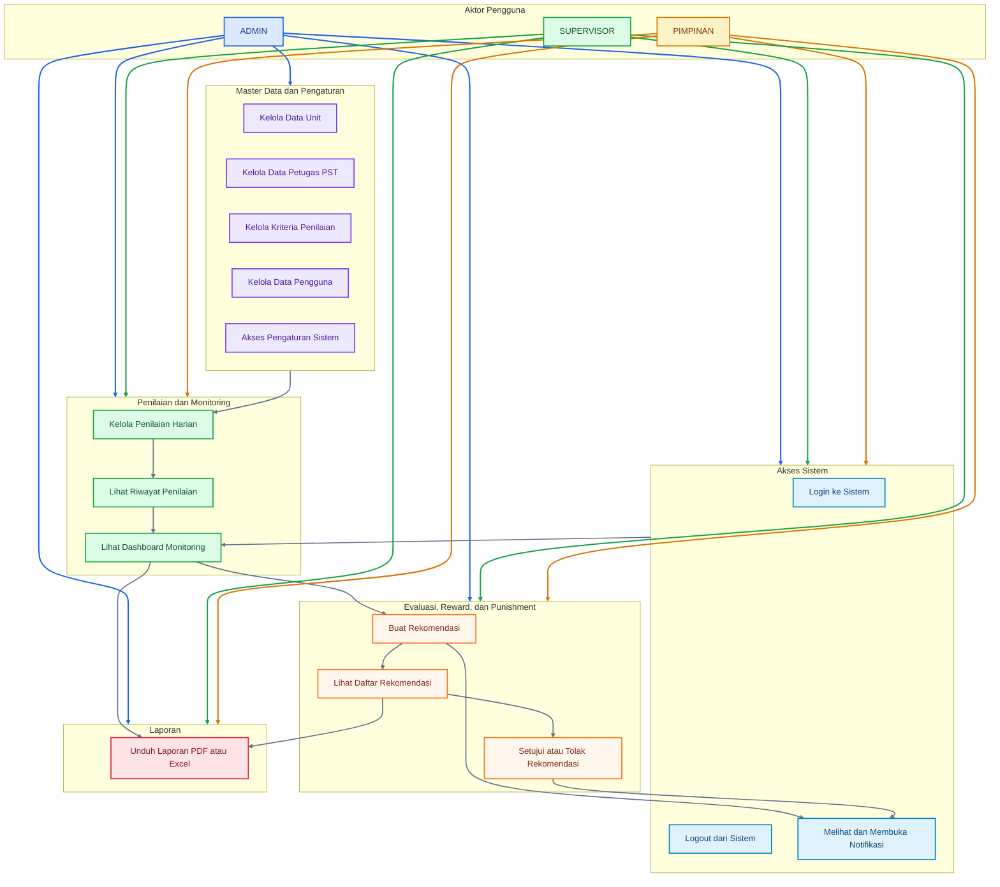

## Rincian Use Case

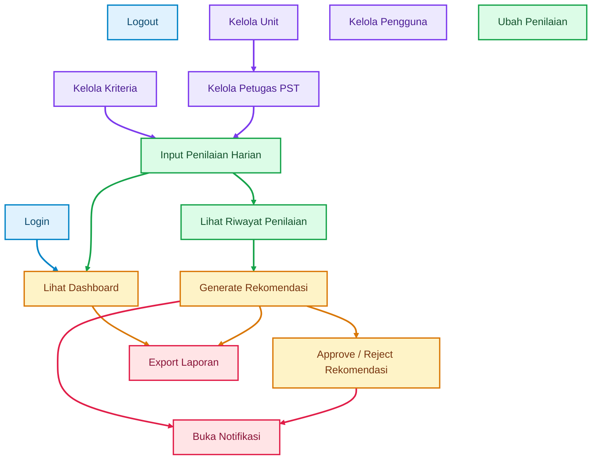

## Perancangan Activity Diagram

Activity diagram menggambarkan alur aktivitas pengguna dan sistem dalam menjalankan proses utama SIMON PST. Pada proyek ini, aktivitas utama meliputi proses penilaian harian petugas, pembaruan dashboard, pembuatan rekomendasi Evaluasi, Reward, dan Punishment, persetujuan rekomendasi oleh PIMPINAN, serta pengunduhan laporan.

## Activity Diagram Penilaian Harian

Proses penilaian menggambarkan alur mulai dari Pimpinan masuk ke aplikasi, membuka menu penilaian, memilih petugas, mengisi skor berdasarkan kriteria, melakukan validasi data, menyimpan penilaian, sampai sistem memperbarui riwayat penilaian dan rekap dashboard.

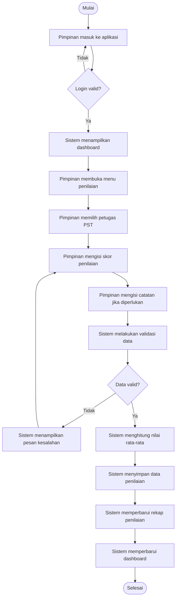

## Activity Diagram Evaluasi, Reward, dan Punishment

Proses Evaluasi, Reward, dan Punishment dimulai dari ADMIN atau SUPERVISOR memilih periode penilaian, sistem menghitung rata-rata penilaian petugas, menghasilkan rekomendasi, lalu PIMPINAN meninjau dan menentukan keputusan persetujuan atau penolakan.

```mermaid
flowchart LR
  Start([Mulai])
  Login["Login"]

  subgraph GenerateFlow["Generate Rekomendasi"]
    OpenModule["Buka menu evaluasi"]
    SelectPeriod["Pilih periode"]
    SelectMode["Pilih mode"]
    Aggregate["Agregasi penilaian"]
    CandidateCheck{"Ada kandidat?"}
    EmptyState["Tampilkan data kosong"]
    Generate["Buat rekomendasi"]
    SaveRecommendation["Simpan RECOMMENDED"]
    NotifyLeader["Notifikasi PIMPINAN"]
  end

  subgraph DecisionFlow["Keputusan PIMPINAN"]
    LeaderOpen["Buka daftar rekomendasi"]
    Review["Tinjau detail"]
    Decision{"Keputusan"}
    Approve["Setujui"]
    Reject["Tolak"]
    SaveDecision["Simpan keputusan"]
    NotifyResult["Notifikasi hasil"]
    UpdateList["Update daftar"]
  end

  Finish([Selesai])

  Start --> Login
  Login --> OpenModule
  OpenModule --> SelectPeriod
  SelectPeriod --> SelectMode
  SelectMode --> Aggregate
  Aggregate --> CandidateCheck
  CandidateCheck -- Tidak --> EmptyState
  EmptyState --> Finish
  CandidateCheck -- Ya --> Generate
  Generate --> SaveRecommendation
  SaveRecommendation --> NotifyLeader
  NotifyLeader --> LeaderOpen
  LeaderOpen --> Review
  Review --> Decision
  Decision -- Disetujui --> Approve
  Decision -- Ditolak --> Reject
  Approve --> SaveDecision
  Reject --> SaveDecision
  SaveDecision --> NotifyResult
  NotifyResult --> UpdateList
  UpdateList --> Finish
```

## Activity Diagram Laporan

Proses laporan digunakan untuk melihat dan mengunduh data penilaian maupun rekomendasi dalam bentuk PDF atau Excel berdasarkan filter periode, unit, petugas, status, atau jenis rekomendasi.

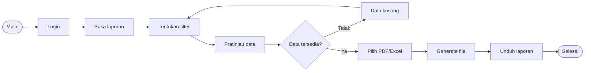

## Alur Autentikasi dan Otorisasi

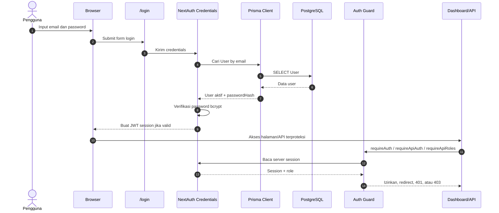

## Alur Penilaian Harian

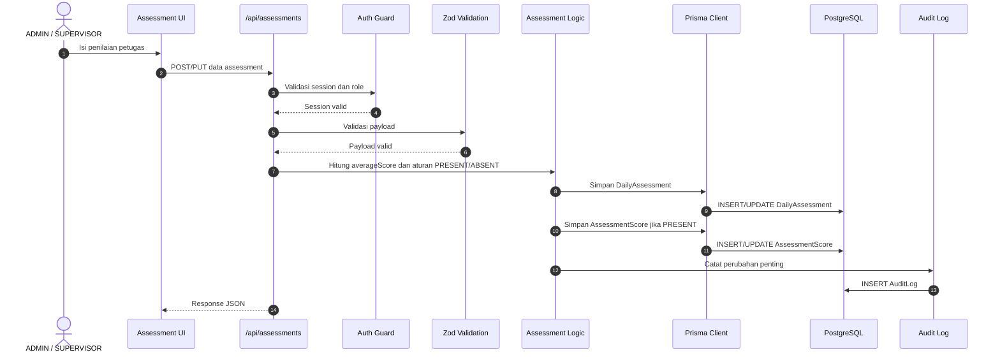

## Alur Evaluasi, Reward, dan Punishment

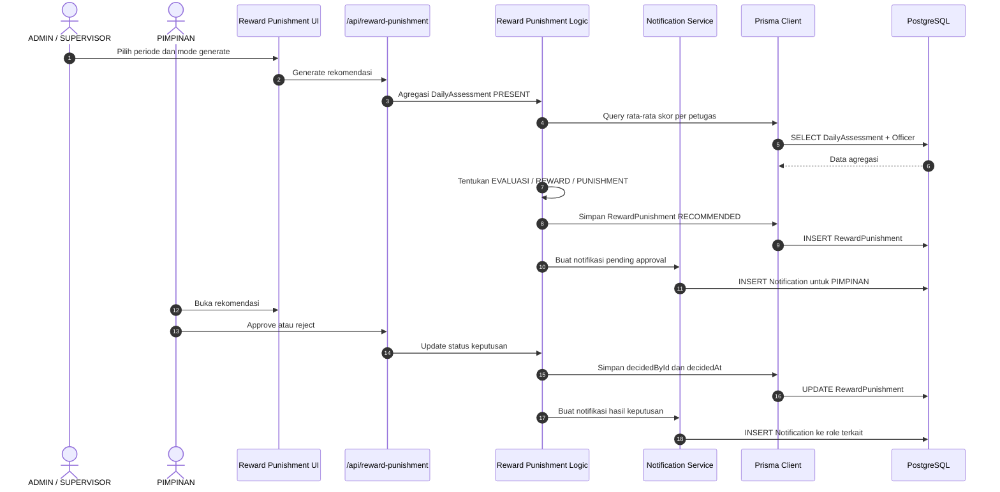

## Alur Dashboard dan Laporan

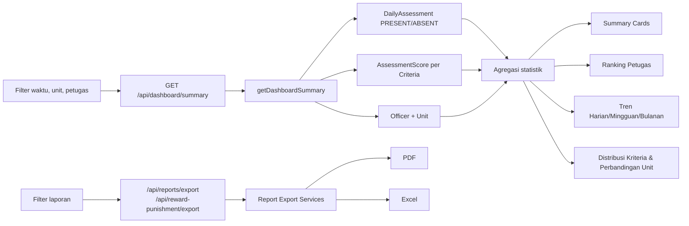

## Alur Notifikasi

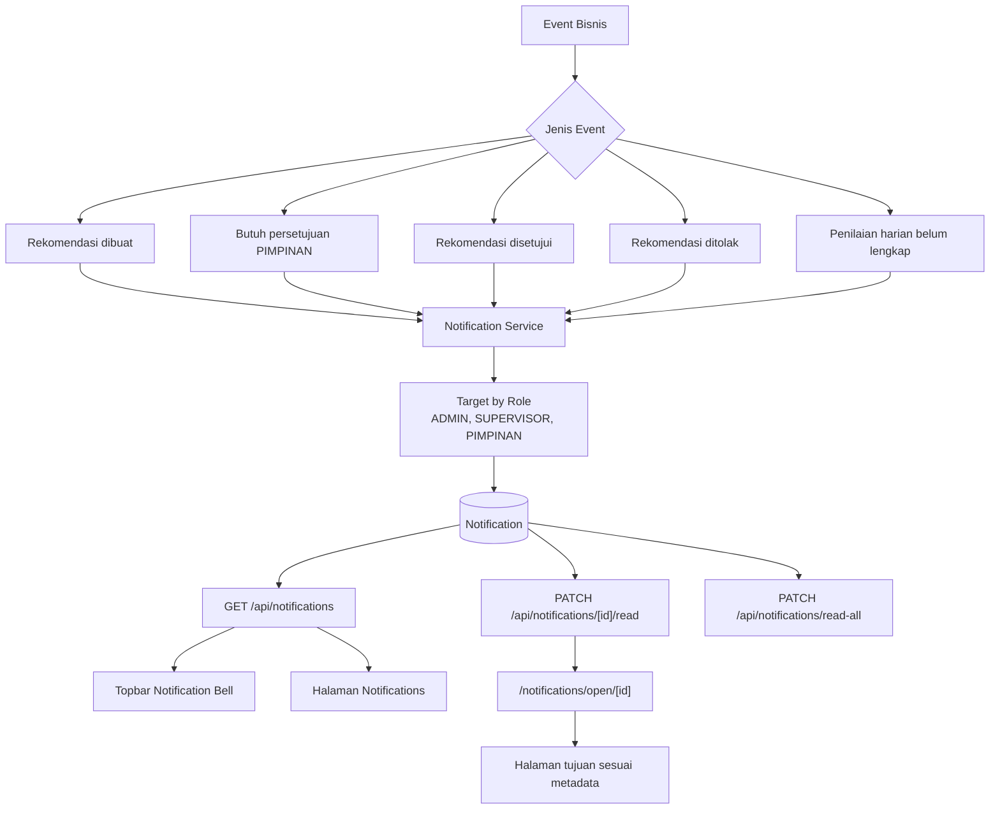

## Entity Relationship Diagram SIMON Petugas PST

Entity Relationship Diagram SIMON Petugas PST menggambarkan hubungan data utama pada sistem, mulai dari pengguna aplikasi, unit kerja, petugas PST, kriteria penilaian, penilaian harian, skor per kriteria, rekomendasi Evaluasi, Reward, dan Punishment, audit log, hingga notifikasi.

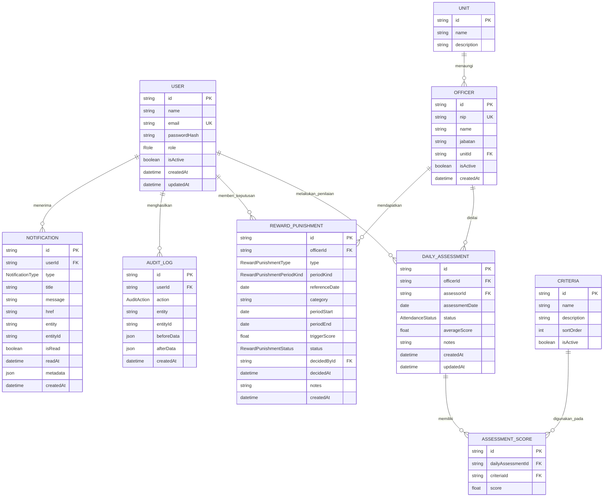

## ERD Database

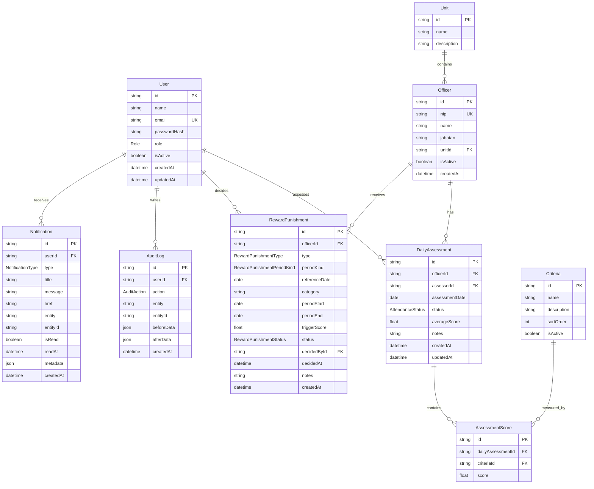

## Matriks Peran dan Akses

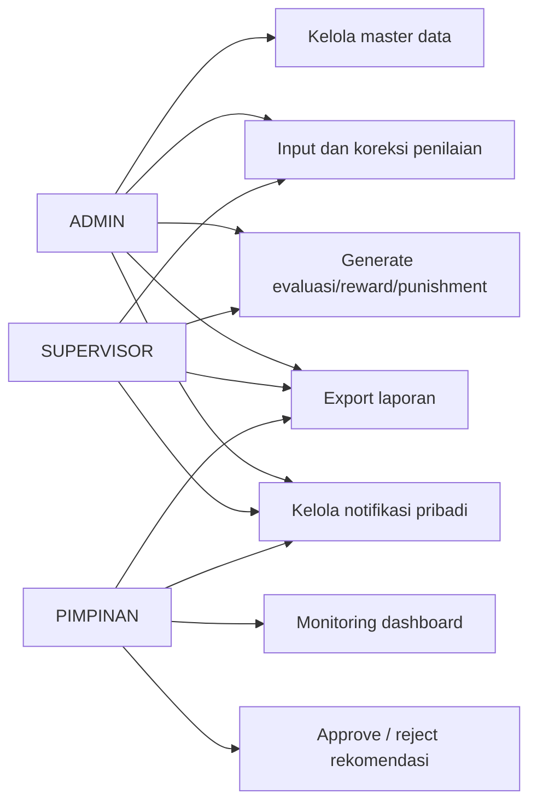

## Deployment Internal

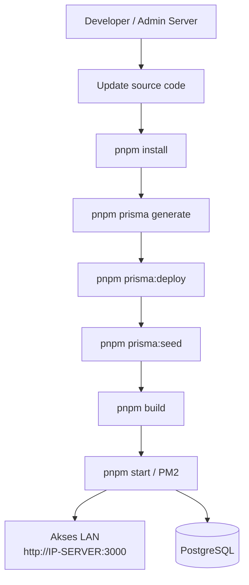

## Catatan Desain

- Arsitektur saat ini cocok untuk deployment internal karena seluruh komponen aplikasi berjalan dalam satu Next.js app.
- Prisma menjadi batas utama antara application layer dan PostgreSQL.
- NextAuth Credentials dipakai untuk login internal berbasis email dan password hash bcrypt.
- Role utama adalah `ADMIN`, `SUPERVISOR`, dan `PIMPINAN`.
- Data histori seperti penilaian, keputusan evaluasi/reward/punishment, audit log, dan notifikasi dipertahankan di database.
- Notifikasi dibuat dari event bisnis dan diarahkan ke halaman tujuan melalui metadata.
- Export laporan dipisahkan sebagai service agar endpoint laporan tidak mencampur query, format, dan rendering dokumen secara berlebihan.
